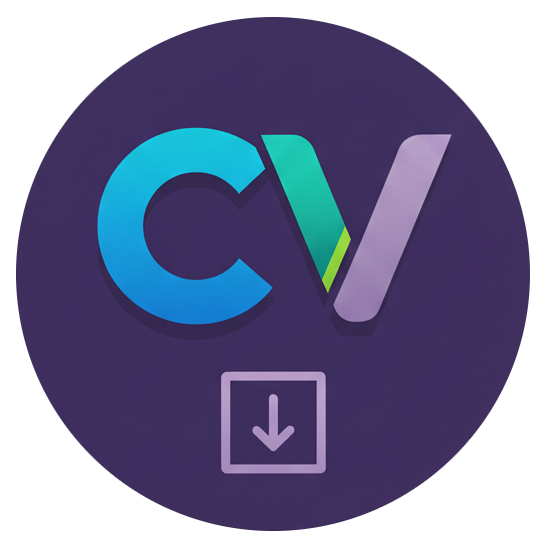

# ChannelVault



**Private, fast, and local desktop viewer and search engine for Slack export archives.**

[](https://go.dev)
[](https://wails.io)
[](https://svelte.dev)
[](https://vitejs.dev)
[](https://www.sqlite.org/fts5.html)
[](LICENSE)

---

## Overview

**ChannelVault** is a modern, cross-platform desktop application built with [Wails](https://wails.io) and [Svelte 5](https://svelte.dev). It allows teams, researchers, and individuals to import, browse, search, and preserve Slack workspace export archives (`.zip`) offline on their local machines.

Zero telemetry, zero cloud dependency — all your communications, channels, threads, and binary attachments are parsed and stored in a private embedded SQLite database on your device.

---

## Features

- **Offline & Private:** All data is parsed locally into SQLite with WAL mode. Nothing is sent to third-party servers.
- **Full Workspace Preservation:**
  - Public, private, and archived channels
  - User profiles, display names, and avatars
  - Threaded replies and conversations
  - Message edit histories and revisions
  - Reactions and standard Slack emoji rendering
- **Instant Full-Text Search (SQLite FTS5):** Blazing-fast BM25 full-text search across all imported messages with keyword highlighting and instant navigation to the source message.
- **Virtualized High-Performance UI:** Smoothly scroll through channels containing tens of thousands of messages with keyset pagination and virtualized DOM rendering (`virtua`).
- **Binary & Media Management:** Download and cache workspace images, media, and attachments locally for offline browsing.
- **Import Manager with Checkpointing:** Manage multiple workspace imports, rename archives, track import progress, and safely resume interrupted jobs.

---

## Tech Stack

| Layer | Technology |
| :--- | :--- |
| **Desktop Framework** | [Wails v2.17](https://github.com/wailsapp/wails) |
| **Backend** | [Go 1.27](https://go.dev) |
| **Database & Search** | Embedded SQLite3 with [FTS5](https://www.sqlite.org/fts5.html) full-text search |
| **Frontend UI** | [Svelte 5](https://svelte.dev) (Runes) + [TypeScript](https://www.typescriptlang.org) |
| **Build & Dev Tool** | [Vite 7](https://vitejs.dev) |
| **Markdown & Emoji** | [Carta](https://beartocode.github.io/carta/) + [emoji-js](https://github.com/iamcal/js-emoji) |
| **Linter / Formatter** | [Biome](https://biomejs.dev) |

---

## Prerequisites

### 1. Go and Node.js (via [mise](https://mise.jdx.dev) recommended)

ChannelVault is configured for seamless development using `mise`:

```bash
mise use -g go@1.27.3
mise use -g node@lts
mise use -g "go:github.com/wailsapp/wails/v2/cmd/wails@v2.17.1"
```

### 2. Linux Dependencies (EndeavourOS / Arch / Ubuntu / Debian)

- **Arch / EndeavourOS:**

  ```bash
  sudo pacman -S gtk3 webkit2gtk-4.1 pkgconf gcc
  ```

- **Ubuntu / Debian:**

  ```bash
  sudo apt-get install -y libgtk-3-dev libwebkit2gtk-4.1-dev pkg-config gcc
  ```

---

## Development

### 1. Install Frontend Dependencies

```bash
cd frontend && npm install && cd ..
```

### 2. Run Live Development Mode

Start the live development environment with hot-reloading (backend + frontend):

```bash
make dev
```

*(Runs `wails dev -tags webkit2_41,fts5`)*

During development, the frontend dev server is accessible in your browser at `http://localhost:34115` with Go bindings available in devtools.

### 3. Run Backend & Frontend Tests

```bash
# Run backend test suite with coverage
make test

# Run frontend type and syntax checks
cd frontend && npm run check
```

---

## Building for Production

To produce a self-contained, optimized native desktop binary for your current OS:

```bash
make build
```

*(Outputs the executable to `build/bin/ChannelVault`)*

### Cross-Compilation (Windows from Linux)

```bash
make buildwin
```

---

## Project Structure

```text
├── backend/
│   ├── app/            # Application lifecycle, Wails IPC methods, and changelog
│   ├── app_helpers/    # Logging helpers and custom slog handlers
│   ├── importer/       # Zip parser, checkpointing, and binary downloader
│   ├── models/         # Go struct models for Slack schema and Wails bindings
│   └── repository/     # SQLite database migrations, queries, and FTS5 search
├── frontend/
│   ├── src/
│   │   ├── lib/
│   │   │   ├── components/  # Svelte 5 components (Message, SlackImport, Search, etc.)
│   │   │   └── types.ts     # Frontend TypeScript types
│   │   ├── App.svelte       # Main three-pane desktop layout
│   │   └── main.ts          # Frontend entry point
│   └── wailsjs/             # Auto-generated Wails JS/TS bindings
├── build/                   # Application icons, packaging metadata, and binaries
├── main.go                  # Main entry point and Wails window options
├── Makefile                 # Development, build, and test task targets
└── wails.json               # Wails application configuration
```

---

## License & Copyright

ChannelVault is open-source software released under the [MIT License](LICENSE).

```text
Copyright (c) mestr.io (info@mestr.io)
```

---

## Third-Party Software & Attributions

ChannelVault bundles and relies on open-source libraries and assets. We gratefully acknowledge the following projects and their copyright holders:

### Backend Libraries (Go)

| Library | License | Copyright |
| :--- | :--- | :--- |
| [Wails](https://github.com/wailsapp/wails) | MIT | Copyright (c) 2018-present Lea Anthony & Wails Contributors |
| [go-sqlite3](https://github.com/mattn/go-sqlite3) | MIT | Copyright (c) 2014 Yasuhiro Matsumoto |
| [xdg](https://github.com/adrg/xdg) | MIT | Copyright (c) 2018-present Adrian Rostovsky |
| [testify](https://github.com/stretchr/testify) | MIT | Copyright (c) 2012-present Mat Ryer, Tyler Bunnell and contributors |
| [golang.org/x/net](https://pkg.go.dev/golang.org/x/net) | BSD-3-Clause | Copyright (c) 2009 The Go Authors |

### Frontend Libraries (JavaScript / TypeScript)

| Library | License | Copyright |
| :--- | :--- | :--- |
| [Svelte](https://github.com/sveltejs/svelte) | MIT | Copyright (c) 2016-present Svelte Contributors |
| [Vite](https://github.com/vitejs/vite) | MIT | Copyright (c) 2019-present Evan You & Vite Contributors |
| [virtua](https://github.com/inokawa/virtua) | MIT | Copyright (c) 2023-present inokawa |
| [carta-md](https://github.com/BearToCode/carta) | MIT | Copyright (c) 2023-present BearToCode |
| [isomorphic-dompurify](https://github.com/kkomelin/isomorphic-dompurify) / [DOMPurify](https://github.com/cure53/DOMPurify) | MIT / Apache-2.0 | Copyright (c) 2020-present Konstantin Komelin / Copyright (c) 2014-present Cure53 |
| [emoji-js](https://github.com/iamcal/js-emoji) | MIT | Copyright (c) 2014-present Cal Henderson |
| [svelte-splitpanes](https://github.com/orefalo/svelte-splitpanes) | MIT | Copyright (c) 2023-present Olivier Refalo |
| [Biome](https://github.com/biomejs/biome) | MIT / Apache-2.0 | Copyright (c) 2023-present Biome Authors & Emanuele Stoppa |
| [TypeScript](https://github.com/microsoft/TypeScript) | Apache-2.0 | Copyright (c) Microsoft Corporation |
| [tslib](https://github.com/Microsoft/tslib) | 0BSD | Copyright (c) Microsoft Corporation |

### Fonts & Assets

| Asset | License | Copyright |
| :--- | :--- | :--- |
| [Nunito Font](https://fonts.google.com/specimen/Nunito) | [SIL Open Font License 1.1](frontend/src/assets/fonts/OFL.txt) | Copyright (c) 2016 The Nunito Project Authors (contact@sansoxygen.com) |
